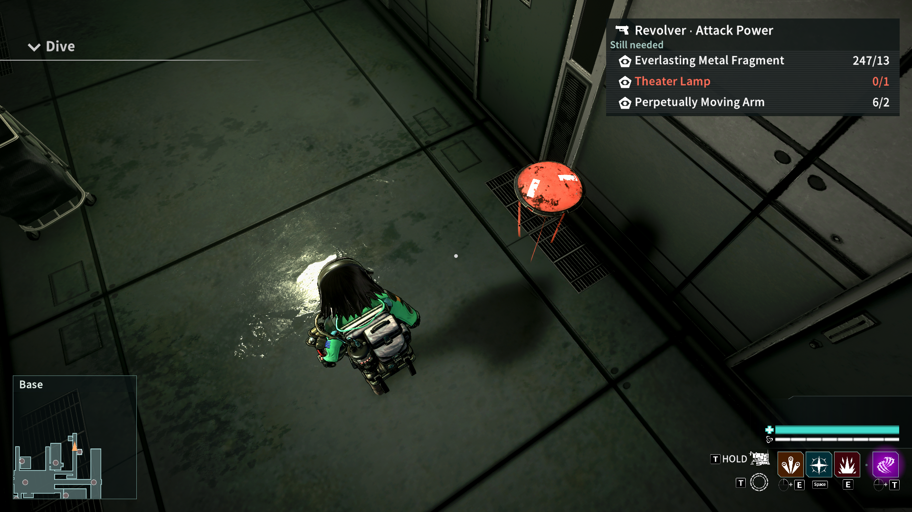
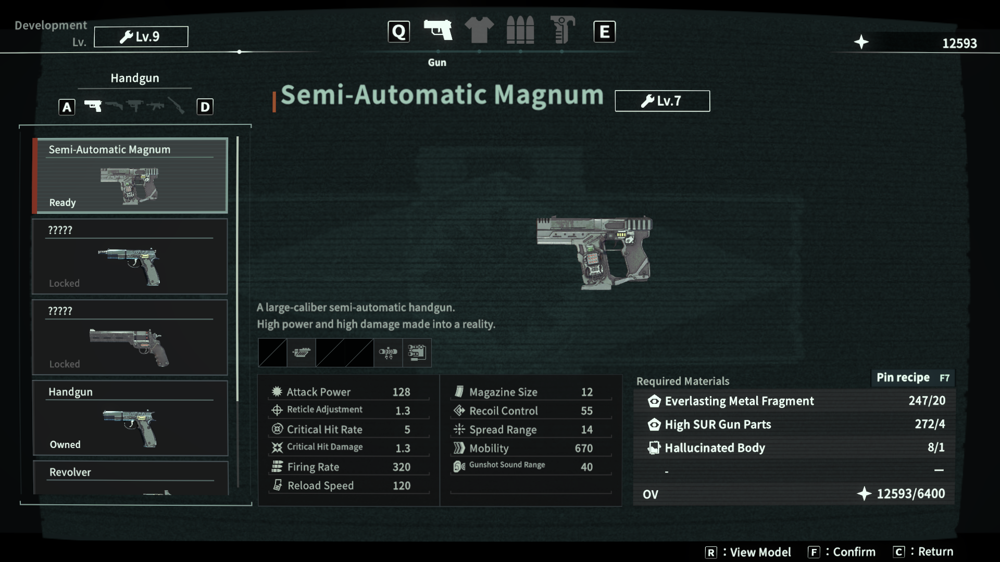
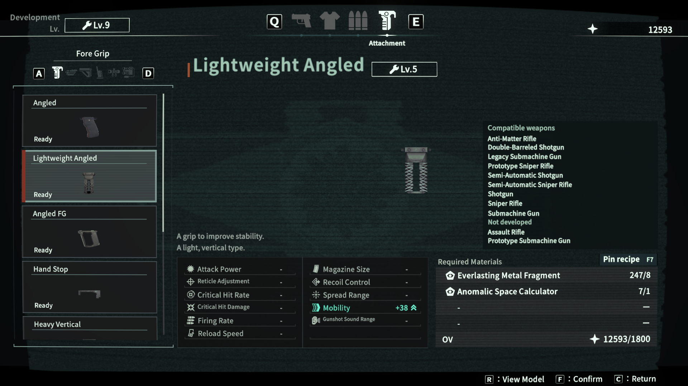
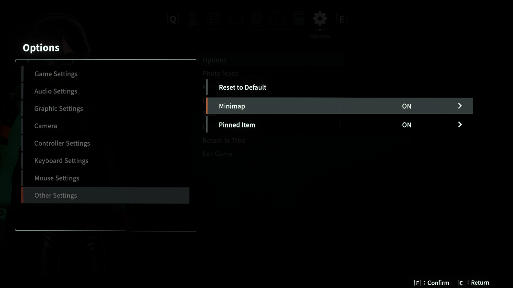

# ANOMALITH Mods

BepInEx mods for the Windows x64 Unity Mono build of [ANOMALITH on Steam](https://store.steampowered.com/app/4017880/ANOMALITH/).

## Quick install

1. Open the folder containing `Anomalith.exe`. In Steam, right-click ANOMALITH and choose **Manage → Browse local files**.
2. If needed, extract [BepInEx 5.4.23.6 for Windows x64](https://github.com/BepInEx/BepInEx/releases/tag/v5.4.23.6) into that folder. Launch the game once, then close it.
3. With the game closed, extract the [v1.0.5 release ZIP](https://github.com/dienp/anomalith-mods/releases/download/v1.0.5/anomalith-mods-v1.0.5.zip) into the folder containing `Anomalith.exe`. To install just one mod, copy its standalone DLL into `BepInEx/plugins`.
4. Launch the game. BepInEx loads the mods automatically.

If upgrading from v1.0.1 or v1.0.2, remove the old Minimap and Upgrade Tracker DLLs from `BepInEx/scripts` to avoid loading duplicates.

## Mods

| Mod | What it does |
| --- | --- |
| [Upgrade Tracker](apps/anomalith-upgrade-tracker/README.md) | Pins Workshop recipes, highlights material sources on Deploy, and shows which weapons fit the attachment highlighted in **Workshop → Development → Attachment**. |
| [Minimap](apps/anomalith-minimap/README.md) | Shows the native floor plan, player position, and points of interest during gameplay. |
| [Auto Reload](apps/anomalith-auto-reload/README.md) | Starts a normal reload when the equipped firearm runs empty and spare ammo is available. Toggle it in **Options → Other Settings**. |
| [Quick Weapon Switch](apps/anomalith-quick-switch/README.md) | Speeds up weapon swaps and cycles assigned weapons on the first scroll notch. Use **Options → Other Settings** for the ON/OFF toggle and **Switch Speed** slider (1.0×–3.0×, default 2.0×). |

## Screenshots

### Minimap and upgrade checklist

### Pin a Workshop recipe

### Attachment compatibility

### Visibility settings

## Build from source

Use a local copy of ANOMALITH, the .NET 8 SDK, and BepInEx 5.
Each mod README has build commands. The Upgrade Tracker also includes
instructions to regenerate its material source index from your game files.

Run `npm ci` at the repository root to install the pinned OpenSpec CLI for the
validation commands in each mod README.
